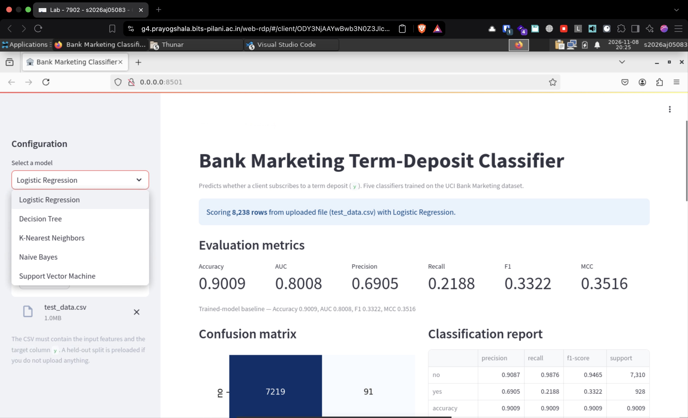
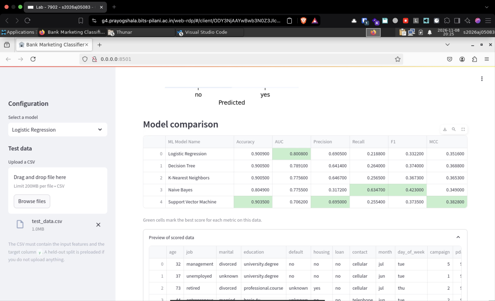
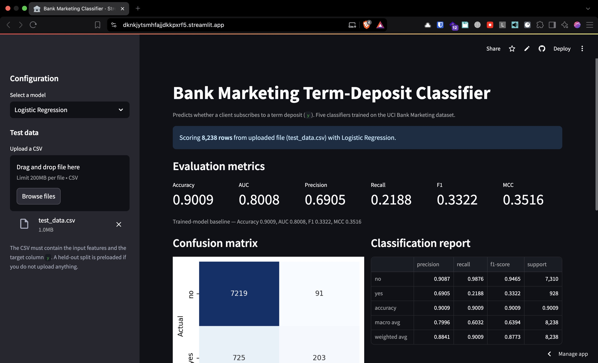

# ML Assignment 2

**Name:** Abhishek B. Patil
**Student ID:** 2026AJ05083

---

## Links

**GitHub Repo:** https://github.com/maverikkano/ML-Assignment-2
**Streamlit Cloud App:** https://dknkjytsmhfajjdkkpxrf5.streamlit.app/

## a. Problem statement

A bank calls customers to sell term deposits. Calling everyone is costly, and only
about one in nine customers says yes. The goal is to predict whether a customer
will subscribe (`y = yes` or `no`) from the customer's details and the campaign
details.

This is a binary classification problem. A model that ranks customers by how
likely they are to subscribe lets the bank call the right people first and spend
less money.

We build five classification models on one dataset and compare them:
Logistic Regression, Decision Tree, K-Nearest Neighbor, Naive Bayes and Support
Vector Machine.

---

## b. Dataset description

**Dataset:** Bank Marketing, from the UCI Machine Learning Repository
(dataset ID 222, file `bank-additional-full.csv`).
**Link:** <https://archive.ics.uci.edu/dataset/222/bank+marketing>

- **Rows:** 41,188
- **Columns:** 21 in the raw file. We use 20 of them and drop `duration`.
- **Target column:** `y`, with `yes` (4,640 rows, 11.3%) and `no` (36,548 rows,
  88.7%). The classes are imbalanced.
- **Data types:** 10 categorical columns (`job`, `marital`, `education`,
  `default`, `housing`, `loan`, `contact`, `month`, `day_of_week`, `poutcome`)
  and 11 numeric columns (`age`, `duration`, `campaign`, `pdays`, `previous`,
  `emp.var.rate`, `cons.price.idx`, `cons.conf.idx`, `euribor3m`, `nr.employed`).
- **Missing values:** none. Some categorical columns use the word `unknown`
  instead of a blank.
- **Why we drop `duration`:** it is the length of the last phone call, and we
  only know it after the call ends. If we keep it, the model learns from
  information it would not have in real use, and the scores look unrealistically
  high.

The file is stored at `data/bank-additional/bank-additional-full.csv`. It uses
`;` as the separator.

---

## c. Models used

All five models use the same data and the same preprocessing:

1. Split the data 80/20 with the same class ratio in both parts. This gives
   32,950 rows for training and 8,238 rows for testing.
2. Convert categorical columns to numeric with one-hot encoding.
3. Scale numeric columns to a common range with standardisation.
4. Train each model on the converted training data.

The preprocessing steps are fitted on the training data only and saved to
`model/preprocessor.joblib`. Each model is saved separately in `model/`. The app
loads these saved files, so nothing is retrained when the app runs.

### Comparison table

| ML Model Name | Accuracy | AUC | Precision | Recall | F1 | MCC |
|---|---|---|---|---|---|---|
| Logistic Regression | 0.9009 | 0.8008 | 0.6905 | 0.2188 | 0.3322 | 0.3516 |
| Decision Tree | 0.9005 | 0.7891 | 0.6414 | 0.2640 | 0.3740 | 0.3688 |
| KNN | 0.9003 | 0.7757 | 0.6458 | 0.2554 | 0.3660 | 0.3641 |
| Naive Bayes | 0.8049 | 0.7755 | 0.3172 | 0.6347 | 0.4230 | 0.3490 |
| Support Vector Machine | 0.9035 | 0.7062 | 0.6950 | 0.2554 | 0.3735 | 0.3828 |

All scores are on the 8,238 test rows in `test_data.csv`. The positive class is
`yes`. AUC uses the predicted probability for the four models that can give one.
The Support Vector Machine cannot, so its AUC uses the distance from the decision
boundary.

### Observations

| ML Model Name | Observation about model performance |
|---|---|
| Logistic Regression | Best AUC (0.8008), so it ranks customers best. It is careful: precision is high (0.6905) but recall is low (0.2188), so it misses many real subscribers. It picks up the economic columns well (`euribor3m`, `nr.employed`, `emp.var.rate`) and is stable without tuning. |
| Decision Tree | AUC is a little lower than logistic regression, but F1 is better (0.3740) because it finds more positives. With `max_depth=8` it can learn combinations such as job with month and contact type. Its probability estimates are rougher. |
| KNN | Nearly the same accuracy and F1 as the decision tree. It is the weakest on AUC (0.7757) because the data has 62 dimensions after encoding, and with so many dimensions distance between points becomes less meaningful. Scaling matters a lot for this model. |
| Naive Bayes | The odd one out. Lowest accuracy (0.8049) and lowest precision (0.3172), but by far the highest recall (0.6347). It flags too many customers as likely subscribers because the independence assumption does not hold for one-hot columns. Good choice when missing a subscriber costs more than a wasted call. |
| Support Vector Machine | Best accuracy (0.9035), best precision (0.6950) and best MCC (0.3828), but the weakest AUC (0.7062). Its ranking is poor on this imbalanced data even though its default 0.5 cut-off classifies well. We used `probability=False` to keep training time practical. |

**Overall, Winner for the dataset:**

**Support Vector Machine.** It has the best accuracy, precision and MCC. MCC is
the most trustworthy single number here, because accuracy alone is misleading on
an imbalanced dataset: predicting `no` every time is already 88.7% correct.

Four models sit near 0.90 accuracy for that reason. MCC and F1 separate them
properly. Naive Bayes gives up about 10 points of accuracy to get roughly three
times the recall, which is a good trade if a missed subscriber is expensive.

---

## How to run

```bash
pip install -r requirements.txt
python train.py          # optional, retrains the five models
streamlit run app.py
```


The app loads the saved models and does not retrain anything. Upload a CSV with
the input columns and the `y` column, or use the bundled `test_data.csv`, then
pick a model from the dropdown to see its metrics, confusion matrix and
classification report. Upload `test_data.csv` unchanged to reproduce the numbers
in the table above.


## Screenshots

### Prayogshala Portal




### Streamlit App




